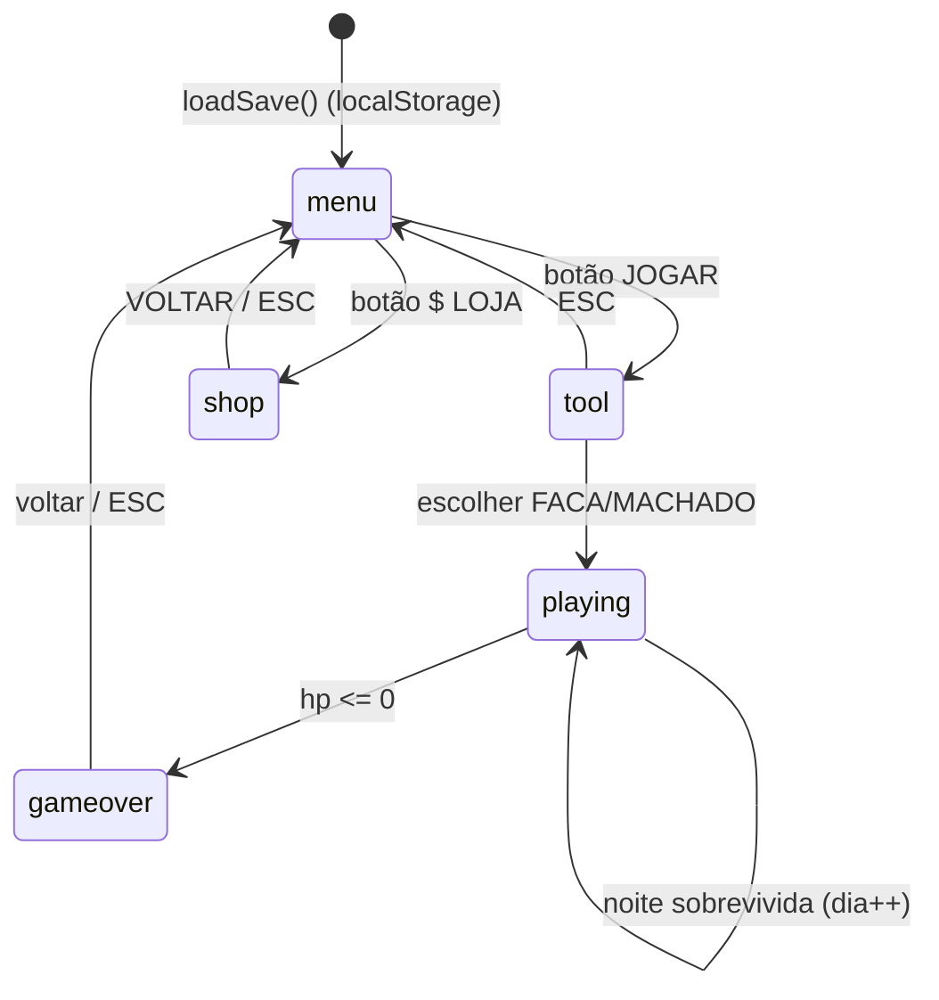
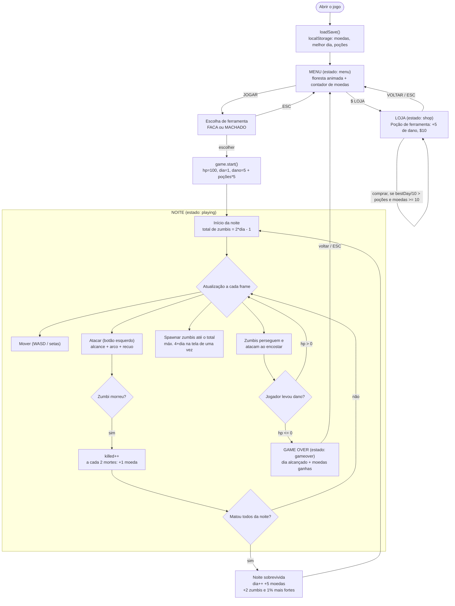

# Fluxograma do jogoSuperlegal

Diagramas do fluxo de jogo, derivados do código em `public/js/` (`main.js`, `game.js`, `save.js`).

## Visão geral (máquina de estados)

O jogo tem 5 estados controlados por `state` em `main.js`: `menu`, `tool`, `playing`, `shop` e `gameover`.

## Fluxo detalhado

## Regras embutidas no fluxo

- **Zumbis por noite:** `total = 2 * dia - 1` (dia 1 = 1, dia 2 = 3, dia 3 = 5...).
- **Escala por noite:** vida e dano dos zumbis multiplicados por `1 + 0,01 * (dia - 1)`.
- **Moedas:** +1 a cada 2 zumbis mortos (contagem continua entre noites) e +5 por noite sobrevivida.
- **Dano do jogador:** `5 + poções * 5`, onde cada poção custa $10 e é liberada a cada 10 dias (melhor dia).
- **Persistência:** `coins`, `bestDay` e `potions` são salvos em `localStorage` a cada mudança.
